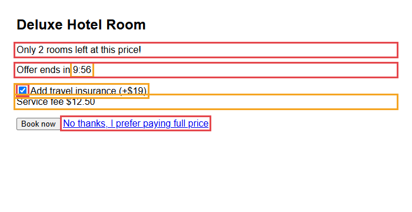
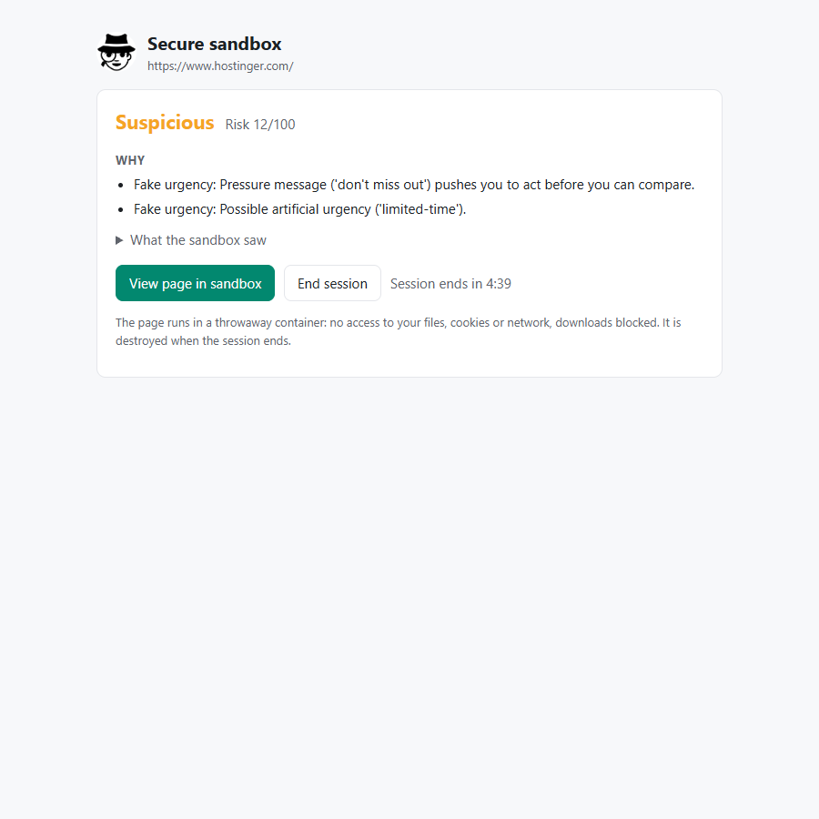
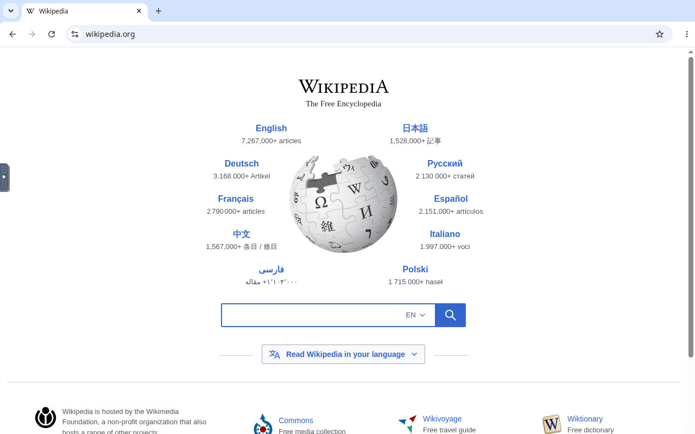
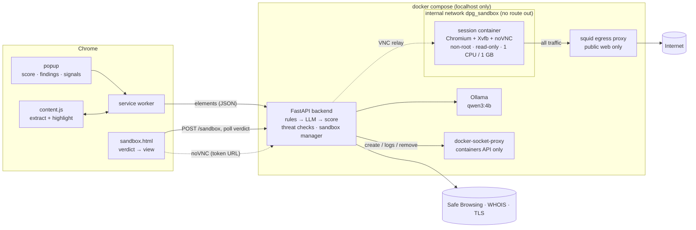

# Dark-Path Guardians

A Chrome extension and local backend that detects **dark patterns** (manipulative UI) and
**threat signals** on the page you're viewing. It also lets you open suspicious links in a
**disposable, hardened sandbox browser** that checks the page *before* you see it.

> **Demo GIF placeholder:** record the popup scanning a shopping page, then a link opened in the
> sandbox, and save it as `docs/demo.gif`.

| Flagged elements on a page | Sandbox verdict, shown first | The page, viewed in the sandbox |
|---|---|---|
|  |  |  |

## What it does

**Detection extension (Manifest V3)**
- Extracts page text, buttons, links, checkboxes, live countdown timers, prices and consent banners.
- Classifies seven dark patterns with a **hybrid** engine. Rules run first. Ambiguous cases go to a
  free, local open-weight LLM (Qwen3 via Ollama).
- Highlights offending elements on the page and shows a **0–100 risk score** in the popup.
- Adds threat signals: **Google Safe Browsing**, **domain age** (WHOIS), **TLS certificate** validity,
  and the **redirect chain**.

**Secure sandbox** ("Open in secure sandbox" in the popup or the link right-click menu)
- Starts a throwaway Docker container with Chromium, shown to you through **noVNC**.
- Loads the page *inside the sandbox first*, runs the same detection pipeline plus network
  monitoring, and shows a **safe / suspicious / block** verdict with reasons.
- The container is hardened (non-root, read-only, no mounts, capped resources, filtered egress,
  downloads blocked) and destroyed after 5 minutes or when you end the session.

| Pattern | Example | Detected by |
|---|---|---|
| `fake_urgency` | "Sale ends in 09:59", "Today only" | rules + LLM, live timer detection |
| `fake_scarcity` | "Only 2 left", "14 people are viewing this" | rules + LLM |
| `preselected_option` | Pre-checked "Add travel insurance" | rules (checkbox state + label) + LLM |
| `hidden_fees` | "Service fee $4.99", total > subtotal + listed charges | rules + LLM |
| `confirmshaming` | "No thanks, I prefer paying full price" | rules + LLM |
| `forced_consent` | Cookie banner with Accept but no Reject; "by using this site you agree" | rules + LLM |
| `disguised_ad` | Ad-network "Download" button styled like the site's | rules (ad slot / ad network) + LLM |

## Architecture



**Detection flow.** Opening the popup injects `content.js` into the active tab (no always-on content
script). It extracts up to 500 elements, each with a CSS selector. The service worker posts them to
`POST /analyze`. The backend runs:

1. **Rules** (`backend/app/rules.py`): plain regexes and heuristics, each with a confidence.
   Findings ≥ 0.8 are accepted as they are.
2. **LLM** (`backend/app/llm.py`): handles rule hits between 0.4 and 0.8, plus unmatched elements that
   contain cue words. It sends batches of 20 to any OpenAI-compatible endpoint, with output constrained
   by a JSON schema. Page text is treated as untrusted data. If the LLM is down, the API falls back to
   rules only.
3. **Threat signals** (`backend/app/threat.py`), run in parallel. Every outbound check goes through an
   SSRF guard (public IPs only, ports 80/443/8080/8443).
4. **Risk score**, as described below.

**Sandbox flow.**
1. `POST /sandbox` creates a container (`backend/app/sandbox.py`).
2. The runner (`sandbox/runner.py`) loads the URL through the egress proxy. It logs redirects, requests,
   popups and download attempts, runs the *same* `content.js` extractor, and prints a report to its logs.
3. The backend reads the report and runs detection and threat checks on the final URL. It then combines
   these with the network features into a verdict (`backend/app/verdict.py`).
4. Only then does the sandbox page offer "View page in sandbox". That opens noVNC through the backend
   at a capability URL; the container publishes no ports.

### Risk score

The score is the sum, over pattern types, of `weight × highest confidence` for that type, plus threat
penalties, capped at 100.

| Pattern | Weight | | Threat signal | Penalty |
|---|---|---|---|---|
| hidden_fees, disguised_ad | 20 | | Safe Browsing match | score = 100 |
| preselected_option, forced_consent, fake_urgency, fake_scarcity | 15 | | any other signal "bad" | +25 |
| confirmshaming | 10 | | any other signal "warn" | +10 |

Sandbox verdict:
- **block**: a Safe Browsing match, an automatic download attempt, a redirect to a blocked address,
  or a score ≥ 70.
- **suspicious**: a score ≥ 30 (network behavior such as redirect hops, leaving the target domain or
  popups adds to the score), or any "bad" signal.
- **safe**: everything else.

## Setup

Requirements: Docker (Docker Desktop on Windows/macOS) and Chrome. About 8 GB RAM is enough for
`qwen3:4b` on CPU.

```bash
git clone <repo> && cd Dark-Path-Guardians
cp .env.example .env            # optional: add SAFE_BROWSING_API_KEY
docker compose up --build -d    # first run builds the sandbox image and pulls the model (several GB)
curl http://127.0.0.1:8000/health
```

Build the extension: `python scripts/build_extension.py`. It checks the manifest and writes
`dist/dark-path-guardians/` (to load) and `dist/dark-path-guardians-<version>.zip` (for the Chrome Web
Store or Edge Add-ons). Load it: `chrome://extensions` → enable **Developer mode** → **Load unpacked** →
select `dist/dark-path-guardians/` (or `extension/` directly while developing). Open a shopping page and click the toolbar icon. To try the sandbox, use the popup's
**Open in secure sandbox** button, or right-click any link → **Open link in secure sandbox**.

### Configuration (`.env`)

| Variable | Default | Meaning |
|---|---|---|
| `LLM_ENABLED` | `true` | Set `false` for rules only |
| `LLM_MODEL` | `qwen3:4b` | Any Ollama model; `qwen3:8b` is more accurate with a GPU |
| `LLM_BASE_URL` | set by compose | Any OpenAI-compatible endpoint |
| `LLM_API_KEY` | `ollama` | Only needed for hosted endpoints |
| `LLM_TIMEOUT_S` / `LLM_MAX_ITEMS` | `120` / `40` | Per-request timeout; max elements per page sent to the LLM |
| `LLM_NO_THINK` | `true` | Disable "thinking" on reasoning models |
| `SAFE_BROWSING_API_KEY` | empty | [Free key](https://developers.google.com/safe-browsing/v4/get-started); empty skips the check |
| `THREAT_TIMEOUT_S` | `6` | Timeout for each threat check |
| `SANDBOX_ENABLED` | `true` | Turn the sandbox feature off |
| `SANDBOX_SESSION_SECONDS` | `300` | Session length before the container is destroyed |
| `SANDBOX_MAX_SESSIONS` | `3` | Concurrent sessions |
| `SANDBOX_MEMORY` / `SANDBOX_CPUS` | `1g` / `1.0` | Per-session limits |

No secrets live in the code; `.env` is git-ignored.

### Development without Docker (detection only)

```bash
cd backend
python -m venv .venv && .venv/Scripts/activate     # Linux/macOS: source .venv/bin/activate
pip install -r requirements-dev.txt
ollama pull qwen3:4b                               # optional
LLM_BASE_URL=http://localhost:11434/v1 uvicorn app.main:app --port 8000
```

## Sandbox hardening

| Control | How |
|---|---|
| No host mounts | `volumes={}`; the image bundles everything it needs |
| Non-root | Runs as uid 10001; `no-new-privileges`; all capabilities dropped |
| Read-only | Read-only root filesystem; 512 MB tmpfs `/tmp`, 256 MB `/dev/shm` |
| Resource limits | 1 CPU, 1 GB RAM (no swap), 512 processes |
| Network egress | Internal Docker network with no route out. The only exit is a Squid proxy that refuses private, loopback, link-local and metadata addresses and non-web ports. WebRTC is limited to proxied UDP |
| Downloads blocked | Playwright `accept_downloads=False`, plus a Chromium policy (`DownloadRestrictions=3`) |
| Session timeout | 5 minutes. A reaper removes expired containers every 10 s and on backend start; containers are labeled with their expiry, so this survives restarts |
| Destroyed after use | `docker rm -f` when the session ends, its tab closes, or it times out |
| No published ports | noVNC is relayed by the backend at an unguessable per-session URL; VNC also has a random password |
| Docker API | The backend uses `docker-socket-proxy`, which only allows container endpoints |
| Page → browser | Nothing from the page reaches your real browser except the VNC pixel stream |

## Evaluation

```bash
cd backend && pip install -r requirements-dev.txt && cd ..
python eval/build_dataset.py              # downloads Mathur et al. (GPL-3.0, not committed) and builds the split
python eval/evaluate.py --mode all        # rules vs LLM vs hybrid; updates the table below
```

- **Text set**: single UI strings. Positives come from Mathur et al. 2019, *Dark Patterns at Scale*,
  mapped from its fine-grained types onto ours. Negatives are the "Not Dark Pattern" rows of
  `eval/data/dark.csv`. Strings are de-duplicated. The fixed test split (seed 42) holds 80 strings per
  well-supported type and 320 negatives. Rules were tuned on the **dev split only**.
- **Page set**: 51 live pages captured with the extension's own extractor (`eval/capture.py`).
  Claude drafted the labels; they count only after a human verifies them (see
  [`eval/manual/README.md`](eval/manual/README.md)).

<!-- METRICS:START -->
Model: `qwen3:4b` (local, via Ollama) · split: `test` · generated 2026-11-26

#### Text set (Mathur et al. 2019 + dark.csv negatives)

570 strings (320 negatives). Macro average covers types with n ≥ 10; * marks types with too few examples to trust. 80 out-of-scope dark strings (e.g. activity notifications) are excluded; share of them flagged as some pattern: rules 10%, llm 48%, hybrid 29%.

| Pattern | n | Rules P | R | F1 | Llm P | R | F1 | Hybrid P | R | F1 |
|---|---|---|---|---|---|---|---|---|---|---|
| fake_urgency | 80 | 1.00 | 0.90 | 0.95 | 0.92 | 0.82 | 0.87 | 0.99 | 0.89 | 0.93 |
| fake_scarcity | 80 | 0.99 | 0.95 | 0.97 | 1.00 | 0.90 | 0.95 | 0.99 | 0.95 | 0.97 |
| preselected_option* | 3 | 0.00 | 0.00 | 0.00 | 0.00 | 0.00 | 0.00 | 1.00 | 0.33 | 0.50 |
| hidden_fees* | 3 | 0.00 | 0.00 | 0.00 | 0.40 | 0.67 | 0.50 | 0.33 | 0.33 | 0.33 |
| confirmshaming | 80 | 1.00 | 0.82 | 0.90 | 1.00 | 0.80 | 0.89 | 1.00 | 0.91 | 0.95 |
| forced_consent* | 4 | 0.00 | 0.00 | 0.00 | 0.50 | 1.00 | 0.67 | 0.38 | 0.75 | 0.50 |
| disguised_ad | 0 | (0 FP) | – | – | (8 FP) | – | – | (4 FP) | – | – |
| **Macro avg** | | 1.00 | 0.89 | 0.94 | 0.97 | 0.84 | 0.90 | 0.99 | 0.92 | 0.95 |
| **Any dark pattern** | | 1.00 | 0.86 | 0.92 | 0.93 | 0.86 | 0.90 | 0.95 | 0.91 | 0.93 |

Run time: rules: 0.1s · llm: 2102.5s · hybrid: 379.6s.

#### Manual page set (per page)

Pending review: 0 of 51 pages verified. See `eval/manual/README.md`.

<!-- METRICS:END -->

**What the numbers say**
- On the three well-supported types, **hybrid is best overall** (macro F1 0.95). Rules alone are
  nearly as good (0.94) and almost free. The LLM's main contribution is recall on reworded cases
  (confirmshaming 0.82 → 0.91).
- **LLM-only is the weakest and the slowest** (0.90; about 35 minutes for 650 strings on this
  machine's CPU/GPU split, versus about 6 minutes for hybrid). Its precision also drops, and it flags
  48% of out-of-scope strings, such as "N bought this", as some pattern.
- Rules were tuned on the dev split. Before tuning, the same rules scored 0.79 macro F1 on the test
  split. The test split was only scored, never inspected.
- Rows marked * have 3–4 examples. They show that rules miss structure-dependent patterns when
  they're given bare text, nothing more. The page set is where those patterns get measured.
- The LLM and hybrid predictions were computed before one late rule fix (fee-negation, e.g.
  "0% fees"), which only affects `hidden_fees`. Re-run `evaluate.py --mode all` to refresh them.

## Tests

```bash
cd backend
pytest                    # unit tests: rule engine, hybrid routing, SSRF guard, verdicts, hardening options
pytest -m integration     # full sandbox lifecycle against real Docker
```

The integration test needs the proxy and the sandbox image (`docker compose up -d proxy sandbox-image`),
and the Compose **backend must be stopped** (`docker compose stop backend`). Its reaper removes
session containers it didn't create.

## Project layout

```
backend/app/      FastAPI app: rules, llm, classifier (hybrid + score), threat, sandbox, verdict
backend/tests/    unit tests + sandbox integration test
extension/        MV3 extension: content script, service worker, popup, sandbox page
scripts/          build_extension.py: package the extension into dist/
sandbox/          session image: Dockerfile, runner, Chromium policy, Squid config
eval/             dataset builder, page capture, review helper, evaluator, results
```

## Limitations

**Detection**
- Rules are English-only, keyword-based and brittle against rephrasing. Text inside images, canvas,
  closed shadow DOM and cross-origin iframes is invisible to the extractor.
- The text benchmark has one label per string and almost no examples of `hidden_fees`,
  `preselected_option`, `forced_consent` and `disguised_ad`. Those types depend on page structure, so
  they can only really be measured on the page set, which is small and not yet verified.
- We label *claims*, as Mathur et al. do. We can't tell a real deadline from a fake one, except that a
  timer which resets on reload is suspicious.
- The LLM can hallucinate. Its output is schema-constrained and only adds findings at confidence
  ≥ 0.6, but page text could still try prompt injection to hide a pattern. A small local model is
  also slow on CPU (about 50 s per 20-element batch here), so hybrid mode only sends ambiguous
  elements.
- Some rule fixes (consent-banner detection) were made after inspecting page-set output. Treat
  page-set numbers as optimistic until a reviewer has verified the labels.

**Threat signals**
- WHOIS is rate-limited and patchy for many TLDs ("unknown" is common). Safe Browsing needs your own
  key, and checked URLs are sent to Google.
- The SSRF guard resolves DNS before connecting, which leaves a small DNS-rebinding window.

**Sandbox**
- A container is **not a VM**. A kernel or Docker escape would compromise the host. Chromium runs
  with its own sandbox disabled, because the container drops the capabilities it needs; the container
  is the boundary. For hostile targets, run the stack inside a VM.
- The backend can create containers. The socket proxy limits it to container endpoints, but anything
  that can call `POST /containers/create` could, in principle, create a privileged container. Treat
  the backend as a privileged component and keep the API on localhost (the default).
- Egress filtering is by destination IP at the proxy. The sandbox can still reach any public site,
  so it is not an anonymity tool, and pages see your public IP.
- Anyone who has the session URL can view and control the session until it expires.
- Bot-detection walls sometimes treat the sandbox as a robot.
